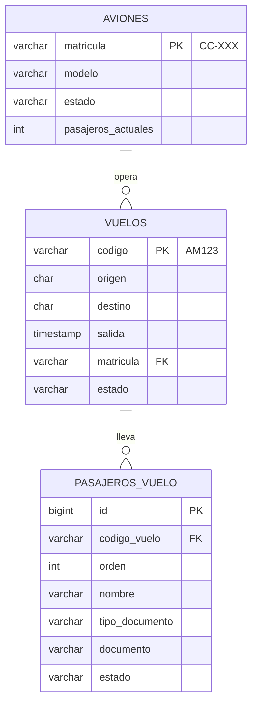
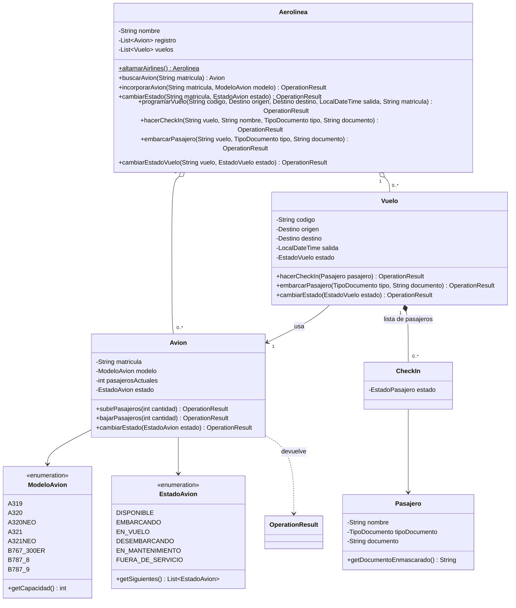
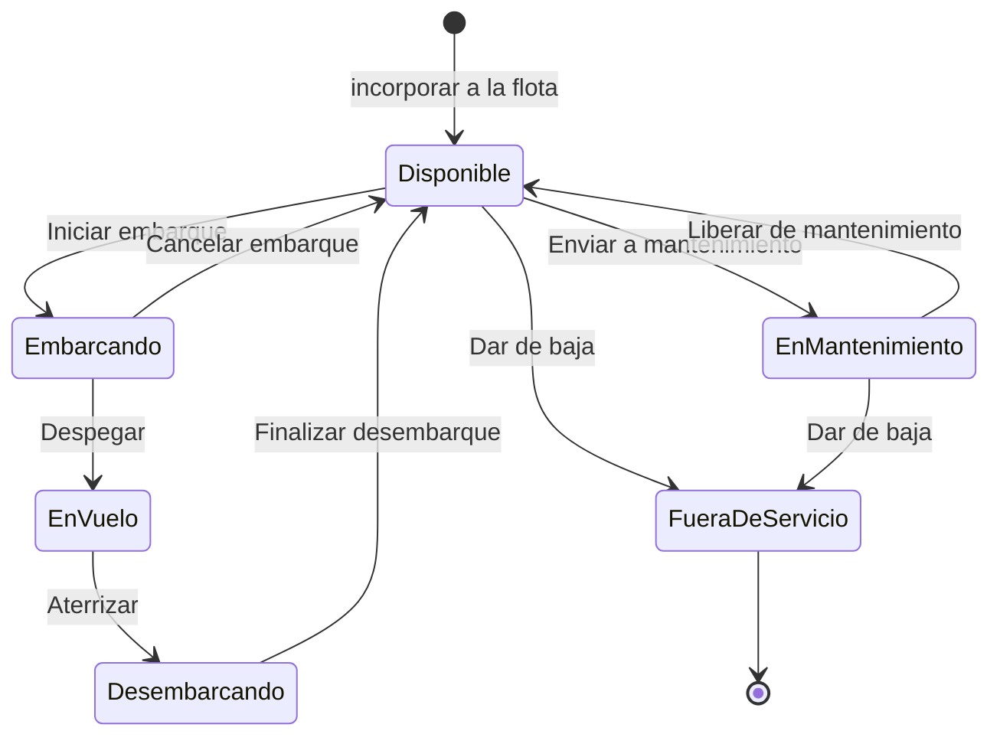
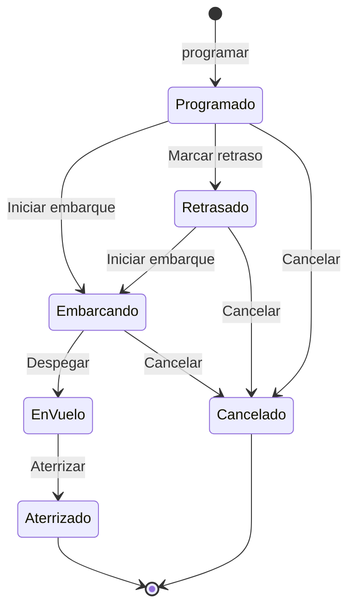

# Altamar Airlines · Gestión de flota y vuelos

[](https://github.com/Pazvzv24/gestion_aeropuerto/actions/workflows/ci.yml)


Sistema de gestión de flota y vuelos para **Altamar Airlines**, una aerolínea ficticia, escrito en **Java 17**. Administra los aviones con matrícula chilena y su estado operativo con reglas de una **máquina de estados**; programa **vuelos** y gestiona sus **pasajeros**: check-in con **RUT validado (módulo 11)** o pasaporte, embarque y lista de pasajeros con el **documento enmascarado**. Tiene **interfaz gráfica moderna** (Swing + FlatLaf, temas claro y oscuro), modo consola y guarda los datos en **PostgreSQL con Docker**, con seguridad desde el diseño.

Proyecto académico de **AIEP**, ramo **Fundamentos de Programación Computacional**, continuado como proyecto de portafolio. Ver [Contexto](#contexto).

---

## Tabla de contenido

- [Funcionalidades](#funcionalidades)
- [Ejecución](#ejecución)
- [Base de datos](#base-de-datos)
- [Pruebas](#pruebas)
- [Estructura del proyecto](#estructura-del-proyecto)
- [Diseño](#diseño)
- [Reglas del negocio](#reglas-del-negocio)
- [Contexto](#contexto)
- [Historial de versiones](#historial-de-versiones)

---

## Funcionalidades

**La flota:** Altamar Airlines opera hoy **15 aviones** y el sistema admite hasta **100** en la flota activa. Cada avión tiene:

- **Matrícula** con el formato chileno `CC-XXX` (por ejemplo, `CC-AMA`).
- **Modelo**, que define su capacidad: Airbus A319, A320, A320neo, A321 y A321neo, y Boeing 767-300ER, 787-8 y 787-9.
- **Estado operativo**: disponible, embarcando, en vuelo, desembarcando, en mantenimiento o fuera de servicio.

**Los vuelos:** cada vuelo tiene código (`AM101`), ruta entre aeropuertos con código IATA (Santiago, Arica, Iquique, Calama, Antofagasta, La Serena, Concepción, Puerto Montt, Punta Arenas, Lima, Buenos Aires, São Paulo y Bogotá), hora de salida, un avión asignado y su lista de pasajeros. Al iniciar la aplicación hay 5 vuelos del día con pasajeros ficticios: uno embarcando, dos programados, uno retrasado y uno cancelado.

**Interfaz gráfica** (modo por defecto):

- **Resumen** con tarjetas: flota activa (de 100), aviones en vuelo, pasajeros a bordo y aviones en mantenimiento.
- Dos pestañas: **Flota** y **Vuelos y pasajeros**.
- **Tabla de la flota** ordenable, con **búsqueda por matrícula** y **filtro por estado**; la ocupación se muestra como barra y el estado en color.
- **Panel de operaciones:** al seleccionar un avión aparecen **solo las acciones que su estado permite** (iniciar embarque, despegar, aterrizar, enviar a mantenimiento, dar de baja…), además de subir y bajar pasajeros.
- **Incorporar aviones** a la flota, validando matrícula y capacidad.
- **Vuelos:** tabla ordenada por hora de salida con filtro por estado; al seleccionar un vuelo se ve su lista de pasajeros y **solo las acciones que su estado permite** (iniciar embarque, marcar retraso, despegar, aterrizar, cancelar).
- **Pasajeros:** check-in con RUT o pasaporte, embarque y anulación de check-in. El documento se muestra siempre enmascarado (`12.345.***-5`).
- **Programar vuelos** eligiendo ruta, fecha y hora, y un avión que no tenga otro vuelo pendiente.
- **Tema claro y oscuro** con un clic.

**Menú por consola** (con el argumento `--consola`, o automáticamente en equipos sin pantalla):

```
--- Altamar Airlines · Gestión de flota ---
1. Listar la flota.
2. Resumen de la flota.
3. Buscar avión por matrícula.
4. Subir pasajeros.
5. Bajar pasajeros.
6. Cambiar estado de un avión.
7. Incorporar avión a la flota.
8. Vuelos y pasajeros.
9. Salir.
Seleccione una opción:
```

La opción 8 abre un submenú para listar vuelos, ver sus pasajeros, programar vuelos, hacer check-in, embarcar, anular check-in y cambiar el estado de un vuelo.

**Datos guardados:** con PostgreSQL configurado, cada operación exitosa se guarda al instante y los datos siguen ahí al volver a abrir la aplicación. Sin configuración, la aplicación funciona igual en memoria. La barra inferior de la ventana indica cuál de los dos modos está en uso.

---

## Ejecución

**Requisitos:** JDK 17 o superior y [Maven](https://maven.apache.org/) 3.9 o superior. Maven descarga solo las librerías (FlatLaf, el driver de PostgreSQL y JUnit). Para guardar los datos, además [Docker Desktop](https://www.docker.com/products/docker-desktop/) (ver [Base de datos](#base-de-datos)).

```bash
# 1. Clonar el repositorio
git clone https://github.com/Pazvzv24/gestion_aeropuerto.git
cd gestion_aeropuerto

# 2. Compilar, ejecutar las pruebas y generar el .jar (incluye FlatLaf y el driver de PostgreSQL)
mvn verify

# 3. Ejecutar la interfaz gráfica
java -jar target/gestion-aeropuerto-2.4.0.jar

# O el menú por consola
java -jar target/gestion-aeropuerto-2.4.0.jar --consola
```

> Si la consola de Windows muestra mal las tildes, ejecuta antes `chcp 65001`.

**Sin instalar Maven:** en Visual Studio Code con el *Extension Pack for Java*, el proyecto se reconoce solo a partir del `pom.xml` (descarga las librerías automáticamente); `Main.java` se ejecuta con ▶ y las pruebas desde el panel *Testing*.

---

## Base de datos

Los datos se guardan en **PostgreSQL 17**, que corre en un contenedor de **Docker**. La primera vez, Docker crea las tablas y el usuario de la aplicación con los scripts de [`db/init`](db/init).

```bash
# 1. Crear el archivo .env a partir del ejemplo y cambiar las dos contraseñas
cp .env.example .env          # en PowerShell: Copy-Item .env.example .env

# 2. Encender la base de datos (la primera vez descarga la imagen de PostgreSQL)
docker compose up -d

# 3. Ejecutar la aplicación: lee el archivo .env y se conecta sola
java -jar target/gestion-aeropuerto-2.4.0.jar
```

Al iniciar con la base vacía, la aplicación guarda los datos de demostración. Para volver a empezar desde cero: `docker compose down -v` (borra los datos) y luego `docker compose up -d`.

### Seguridad de la base de datos

| Medida | Cómo se aplica |
| :--- | :--- |
| **Sin secretos en el código** | Las contraseñas están en el archivo `.env`, que está en `.gitignore`. En el repositorio solo está [`.env.example`](.env.example), sin contraseñas reales. |
| **Contraseñas robustas** | La aplicación rechaza contraseñas de menos de 12 caracteres y la contraseña de ejemplo. |
| **Mínimo privilegio** | La aplicación no usa el superusuario `postgres`: se conecta como `altamar_app`, que no puede crear ni borrar tablas, ni borrar aviones o vuelos, y solo puede cambiar las columnas de estado. Ver [`02_usuario_app.sql`](db/init/02_usuario_app.sql). |
| **Sin inyección SQL** | Todas las consultas usan `PreparedStatement`: lo que escribe el usuario se envía como dato, nunca como parte del SQL. |
| **Reglas también en la base** | Claves primarias y foráneas, `CHECK` (formato de matrícula y de código de vuelo, estados válidos, origen distinto del destino), `UNIQUE` (un documento por vuelo) y un índice que impide dos vuelos pendientes para el mismo avión. |
| **Transacciones** | Cada guardado es una transacción: se guarda todo o nada. |
| **Datos validados al cargar** | Lo que se lee de la base pasa por las mismas reglas del modelo; si alguien modificó la base y dejó algo imposible, la aplicación lo rechaza. |
| **Base solo local** | El puerto se publica en `127.0.0.1:5433`: no es accesible desde otros equipos de la red. |
| **Imagen fija** | `postgres:17.6-alpine` con versión exacta; Dependabot avisa cuando hay una nueva. |
| **Errores sin datos sensibles** | Los mensajes al usuario nunca muestran contraseñas ni detalles internos. |



> Esta configuración está pensada para desarrollo en un computador local. En un servidor real se agregaría, por ejemplo, conexión cifrada (TLS) y un gestor de secretos.

---

## Pruebas

**81 pruebas** con JUnit 5, siguiendo el patrón *Arrange, Act, Assert*:

| Clase de prueba | Qué comprueba |
| :--- | :--- |
| `AvionTest` | Formato de matrícula, capacidad por modelo, subir y bajar pasajeros según el estado, un ciclo de vuelo completo, cambios de estado imposibles, avión con pasajeros que no puede liberarse y validación del constructor |
| `EstadoAvionTest` | Las transiciones permitidas de la máquina de estados, los permisos de pasajeros por estado y los nombres de las acciones |
| `AerolineaTest` | Flota inicial de Altamar (15 aviones, sin matrículas repetidas), totales, búsqueda por matrícula, incorporación de aviones, límite de 100, baja de aviones y lista de solo lectura |
| `RutTest` | Dígito verificador con módulo 11 (incluidos K y 0), RUT con y sin puntos, formato y enmascarado |
| `PasajeroTest` | Validación del nombre y del documento, formato del RUT y del pasaporte, documento enmascarado y que el texto del pasajero nunca muestre el documento completo |
| `EstadoVueloTest` | Transiciones permitidas del vuelo, estados finales y cierre del check-in al despegar |
| `VueloTest` | Check-in sin duplicados ni sobrecupo, embarque que ocupa asientos, pasajeros que no se presentaron, aterrizaje y cancelación que liberan el avión |
| `AerolineaVuelosTest` | Vuelos de demostración, programación con validaciones, un vuelo pendiente por avión, RUT inválido en el check-in y aviones bloqueados en la flota mientras su vuelo embarca o vuela |
| `AerolineaPersistenciaTest` | Reconstruir la aerolínea desde datos guardados, rechazo de datos imposibles y que solo las operaciones exitosas se guarden |
| `ConfiguracionBDTest` | Lectura del archivo `.env`, prioridad de las variables de entorno, rechazo de contraseñas débiles y que la contraseña nunca se muestre |
| `RepositorioPostgresTest` | Con una base PostgreSQL real: guardar y cargar, un intento de inyección SQL que se guarda como texto y que el usuario de la aplicación no pueda borrar aviones ni tablas |
| `MainTest` | Entrada inválida, fin de la entrada, una sesión de flota y otra de vuelos por consola, y el argumento `--consola` |
| `AvionesTableModelTest`, `VuelosTableModelTest`, `PasajerosTableModelTest` | Que las tablas de la interfaz muestren los datos correctos (con el documento enmascarado) y se actualicen tras una operación |

```bash
mvn test
```

Las 3 pruebas de `RepositorioPostgresTest` usan una base de datos real, así que solo se ejecutan en GitHub Actions; en el computador de desarrollo se omiten para no modificar los datos locales.

En cada push, [GitHub Actions](.github/workflows/ci.yml) levanta una base PostgreSQL temporal con Docker Compose (con contraseñas aleatorias que se generan en cada ejecución), compila el proyecto y ejecuta todas las pruebas. [Dependabot](.github/dependabot.yml) avisa si alguna dependencia tiene vulnerabilidades conocidas, y CodeQL analiza la seguridad del código.

---

## Estructura del proyecto

```
gestion_aeropuerto/
├── pom.xml                          # Configuración de Maven
├── docker-compose.yml               # Base de datos PostgreSQL en Docker
├── .env.example                     # Ejemplo de configuración (sin contraseñas reales)
├── LICENSE                          # Licencia MIT
├── db/init/
│   ├── 01_esquema.sql               # Tablas y restricciones
│   └── 02_usuario_app.sql           # Usuario de la aplicación con mínimo privilegio
├── src/
│   ├── main/java/io/github/pazvzv24/aeropuerto/
│   │   ├── Aerolinea.java           # Flota (hasta 100 aviones activos), vuelos y sus operaciones
│   │   ├── Avion.java               # Matrícula, modelo, pasajeros y estado
│   │   ├── ModeloAvion.java         # Modelos y su capacidad
│   │   ├── EstadoAvion.java         # Estados del avión (máquina de estados)
│   │   ├── Vuelo.java               # Código, ruta, salida, avión y lista de pasajeros
│   │   ├── EstadoVuelo.java         # Estados del vuelo (máquina de estados)
│   │   ├── Destino.java             # Aeropuertos con código IATA
│   │   ├── Pasajero.java            # Nombre y documento validado
│   │   ├── TipoDocumento.java       # RUT o pasaporte
│   │   ├── Rut.java                 # Validación (módulo 11), formato y enmascarado del RUT
│   │   ├── CheckIn.java             # Un pasajero dentro de un vuelo
│   │   ├── EstadoPasajero.java      # Check-in, embarcado o no se presentó
│   │   ├── OperationResult.java     # Resultados posibles de una operación
│   │   ├── Main.java                # Punto de entrada (ventana o consola)
│   │   ├── persistencia/
│   │   │   ├── RepositorioAerolinea.java    # Dónde se guardan los datos (interfaz)
│   │   │   ├── RepositorioPostgres.java     # Implementación con PostgreSQL (JDBC)
│   │   │   ├── RepositorioException.java    # Error al leer o guardar
│   │   │   └── ConfiguracionBD.java         # Conexión leída del archivo .env
│   │   └── ui/
│   │       ├── VentanaPrincipal.java    # Ventana con pestañas Flota y Vuelos
│   │       ├── PanelVuelos.java         # Pestaña de vuelos y pasajeros
│   │       ├── AvionesTableModel.java   # Datos de la tabla de la flota
│   │       ├── VuelosTableModel.java    # Datos de la tabla de vuelos
│   │       ├── PasajerosTableModel.java # Datos de la lista de pasajeros
│   │       └── Tema.java                # Temas claro y oscuro (FlatLaf)
│   └── test/java/io/github/pazvzv24/aeropuerto/
│       ├── AvionTest.java
│       ├── EstadoAvionTest.java
│       ├── AerolineaTest.java
│       ├── AerolineaVuelosTest.java
│       ├── VueloTest.java
│       ├── EstadoVueloTest.java
│       ├── PasajeroTest.java
│       ├── RutTest.java
│       ├── AerolineaPersistenciaTest.java
│       ├── MainTest.java
│       ├── persistencia/
│       │   ├── ConfiguracionBDTest.java
│       │   └── RepositorioPostgresTest.java
│       └── ui/
│           ├── AvionesTableModelTest.java
│           ├── VuelosTableModelTest.java
│           └── PasajerosTableModelTest.java
└── .github/
    ├── workflows/ci.yml             # Integración continua
    └── dependabot.yml               # Revisión de dependencias
```

---

## Diseño



### Máquina de estados del avión



Para volver a **Disponible** (al cancelar el embarque o al terminar de desembarcar) el avión debe estar vacío. Cualquier otro cambio, por ejemplo de "En vuelo" a "En mantenimiento" sin aterrizar, se rechaza con `INVALID_TRANSITION`.

### Máquina de estados del vuelo



El vuelo mueve a su avión: **iniciar el embarque** pone el avión en embarque, cada pasajero que **embarca** ocupa un asiento, **despegar** pone el avión en vuelo y **aterrizar** baja a los pasajeros y deja el avión disponible para su siguiente vuelo.

### Patrón Result Object

Las operaciones no lanzan excepciones para los casos esperados (avión lleno, cambio de estado no permitido, etc.): devuelven un `OperationResult` que se puede revisar de forma clara.

```java
OperationResult resultado = altamar.cambiarEstado("CC-AMC", EstadoAvion.EN_MANTENIMIENTO);

if (resultado.isSuccess()) {
    System.out.println("Avión enviado a mantenimiento");
} else {
    System.out.println(resultado.getMessage() + " (código " + resultado.getStatusCode() + ")");
}
```

| Resultado | Código | Mensaje |
| :--- | :---: | :--- |
| `SUCCESS` | 200 | Operación exitosa |
| `CAPACITY_EXCEEDED` | 400 | El avión no tiene asientos suficientes |
| `AIRPLANE_NOT_FOUND` | 404 | Avión no encontrado |
| `FLIGHT_NOT_FOUND` | 404 | Vuelo no encontrado |
| `PASSENGER_NOT_FOUND` | 404 | El pasajero no está en este vuelo |
| `NOT_ENOUGH_PASSENGERS` | 409 | No hay tantos pasajeros a bordo |
| `OPERATION_NOT_ALLOWED` | 409 | Operación no permitida en el estado actual |
| `INVALID_TRANSITION` | 409 | Cambio de estado no permitido |
| `AIRPLANE_NOT_EMPTY` | 409 | El avión aún tiene pasajeros a bordo |
| `AIRPLANE_NOT_AVAILABLE` | 409 | El avión no está disponible para este vuelo |
| `AIRPLANE_ASSIGNED_TO_FLIGHT` | 409 | El avión está operando un vuelo; gestiónelo desde Vuelos |
| `DUPLICATE_REGISTRATION` | 409 | Ya existe un avión con esa matrícula |
| `DUPLICATE_FLIGHT` | 409 | Ya existe un vuelo con ese código |
| `DUPLICATE_PASSENGER` | 409 | El pasajero ya tiene check-in en este vuelo |
| `ALREADY_BOARDED` | 409 | El pasajero ya embarcó |
| `CHECK_IN_CLOSED` | 409 | El check-in de este vuelo está cerrado |
| `FLEET_FULL` | 409 | La flota alcanzó su capacidad máxima |
| `INVALID_AMOUNT` | 422 | Cantidad de pasajeros inválida |
| `INVALID_REGISTRATION` | 422 | Matrícula inválida, use el formato CC-XXX |
| `INVALID_FLIGHT_DATA` | 422 | Datos del vuelo inválidos |
| `INVALID_PASSENGER_DATA` | 422 | Datos del pasajero inválidos |

Los códigos siguen la idea de los códigos HTTP para que sean fáciles de reconocer.

### Separación entre lógica e interfaz

La interfaz gráfica (paquete `ui`) y el menú por consola **usan las mismas clases del modelo**: ninguna regla del negocio está en las pantallas. Por eso la misma lógica funciona con dos interfaces distintas, y las pruebas revisan las reglas sin necesidad de abrir ventanas.

### Validación y encapsulamiento

- **Entrada del usuario:** si se escribe algo inválido, el programa avisa y vuelve a preguntar, en vez de cerrarse con un error.
- **Estado siempre válido:** un avión no puede crearse con una matrícula mal formada, con más pasajeros que asientos, ni con pasajeros en un estado que exige el avión vacío.
- **Operaciones atómicas:** si una operación falla, el avión queda exactamente como estaba.
- **Encapsulamiento:** la flota es privada. `getFlota()` entrega una copia de solo lectura, así nadie puede agregar o quitar aviones sin pasar por las reglas de `Aerolinea`. Lo mismo ocurre con los vuelos y sus listas de pasajeros.

### Datos personales

Los pasajeros tienen datos personales, así que se aplican principios de la **Ley 21.719** de protección de datos:

- **Minimización:** solo se pide nombre y documento, lo necesario para el check-in.
- **Validación:** el RUT se valida con el dígito verificador (módulo 11) antes de guardarlo.
- **Enmascarado:** la interfaz y la consola muestran el documento ocultando parte de los dígitos (`12.345.***-5`, `******930`); el número completo solo se usa dentro del programa para comparar.
- **Acceso restringido:** en la base de datos, los datos personales solo los puede leer el usuario de la aplicación, y cada columna tiene un comentario que indica que es un dato personal.
- **Datos ficticios:** todos los pasajeros de demostración son inventados, con RUT de números repetidos (`11.111.111-1`) que no corresponden a personas.

---

## Reglas del negocio

- Las matrículas siguen el formato chileno `CC-XXX` y no se repiten.
- La capacidad de cada avión la define su modelo.
- Solo se suben pasajeros durante el **embarque**, y hasta completar la capacidad.
- Se bajan pasajeros durante el embarque (si alguien desiste) o al **desembarcar**; nunca en vuelo.
- Un avión solo vuelve a **disponible**, pasa a **mantenimiento** o se da de **baja** si está vacío.
- Los cambios de estado siguen la máquina de estados; un avión **fuera de servicio** ya no admite cambios.
- La flota activa admite como máximo **100 aviones**. Los dados de baja se conservan en el registro como historial, pero no cuentan como flota activa.
- Un vuelo tiene código `AM` y 3 o 4 dígitos, sin repetir, y su origen y destino son distintos.
- Cada avión opera **un vuelo pendiente a la vez**; un avión fuera de servicio no recibe vuelos.
- El **check-in** está abierto hasta el despegue (también si el vuelo está retrasado), sin documentos repetidos ni más pasajeros que asientos.
- Solo embarcan pasajeros con check-in y solo mientras el vuelo está **embarcando**. Al despegar, quien no embarcó queda como **no se presentó**.
- Mientras un vuelo **embarca o vuela**, su avión no se puede operar desde la pestaña Flota; si tiene un vuelo programado, el embarque se inicia desde el vuelo.
- Un vuelo en el aire no se puede cancelar; si se cancela durante el embarque, los pasajeros bajan y el avión queda disponible.

> Altamar Airlines, sus matrículas, vuelos y pasajeros son ficticios; cualquier coincidencia con aviones, empresas o personas reales es casual. Las capacidades de los modelos son referenciales.

---

## Contexto

Este proyecto nació como una evaluación del ramo **Fundamentos de Programación Computacional** (AIEP, primer semestre), en la unidad de introducción a Java. La **v1.0** corresponde a la versión entregada.

Desde la **v1.1** continúa como proyecto de portafolio: corrección de errores, validación de la entrada del usuario y encapsulamiento (v1.1); estructura estándar con Maven, pruebas automáticas e integración continua (v2.0); interfaz gráfica (v2.1); una aerolínea con flota, matrículas, modelos y estados con reglas (v2.2), vuelos con check-in y embarque de pasajeros (v2.3), y datos guardados en PostgreSQL con Docker (v2.4).

No se incluyen el enunciado ni la pauta de evaluación.

---

## Historial de versiones

| Versión | Cambios |
| :--- | :--- |
| v1.0 | Versión entregada en la evaluación: clases `Aeropuerto`, `Avion`, `Pasajero` y `OperationResult`, menú por consola y documentación. |
| v1.1 | Mensaje correcto al bajar más pasajeros de los que hay (`NOT_ENOUGH_PASSENGERS`); el programa ya no se cierra si se escribe texto en vez de un número; validación en los constructores; arreglo de aviones encapsulado; resultado `AIRPLANE_NOT_FOUND`; capacidad aleatoria entre 50 y 150 inclusive; README renovado. |
| v2.0 | Proyecto Maven con paquete `io.github.pazvzv24.aeropuerto` y estructura estándar; 21 pruebas con JUnit 5; integración continua con GitHub Actions; Dependabot; `.jar` ejecutable; licencia MIT. |
| v2.1 | Interfaz gráfica con Swing y FlatLaf: tarjetas de resumen, tabla de aviones con ocupación y estado, panel de operaciones y temas claro y oscuro; el menú por consola sigue disponible con `--consola`; `.jar` único con todas las librerías; 5 pruebas nuevas (26 en total). |
| v2.2 | Altamar Airlines: `Aeropuerto` pasa a ser `Aerolinea`, con flota de 15 aviones y capacidad para 100; matrícula chilena `CC-XXX`; modelos reales con su capacidad (`ModeloAvion`); estados operativos con máquina de estados (`EstadoAvion`); incorporar y dar de baja aviones; búsqueda por matrícula y filtro por estado en la interfaz; 6 resultados nuevos; 32 pruebas. |
| v2.3 | Vuelos y pasajeros: clases `Vuelo`, `EstadoVuelo`, `Destino`, `CheckIn` y `EstadoPasajero`; `Pasajero` con RUT validado (módulo 11) o pasaporte y documento enmascarado (`Rut`, `TipoDocumento`); el vuelo controla el estado y los pasajeros de su avión; pestaña **Vuelos y pasajeros** en la interfaz y submenú en la consola; 5 vuelos de demostración con pasajeros ficticios; 10 resultados nuevos; 67 pruebas. |
| v2.4 | Datos guardados en PostgreSQL 17 con Docker Compose: esquema con restricciones, usuario de la aplicación con mínimo privilegio, contraseñas en `.env`, `PreparedStatement`, transacciones y validación de los datos al cargar; capa `persistencia` (`RepositorioAerolinea`, `RepositorioPostgres`, `ConfiguracionBD`); modo memoria si no hay base de datos; integración continua con una base PostgreSQL real; 81 pruebas. |

---

Distribuido bajo la licencia [MIT](LICENSE).