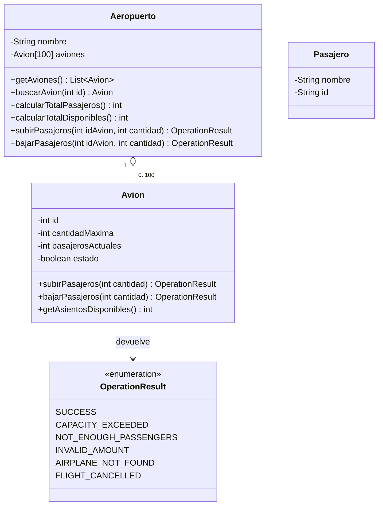

# Sistema de Gestión de Aeropuerto


Simulación orientada a objetos del embarque y desembarque de pasajeros en un aeropuerto, escrita en **Java 17**. Cada operación valida sus reglas y devuelve un resultado explícito (patrón *Result Object*), y toda la entrada del usuario se valida antes de usarse.

Proyecto académico de **AIEP**, ramo **Fundamentos de Programación Computacional**, continuado como proyecto de portafolio. Ver [Contexto](#contexto).

---

## Tabla de contenido

- [Funcionalidades](#funcionalidades)
- [Ejecución](#ejecución)
- [Estructura del proyecto](#estructura-del-proyecto)
- [Diseño](#diseño)
- [Reglas del negocio](#reglas-del-negocio)
- [Contexto](#contexto)
- [Historial de versiones](#historial-de-versiones)

---

## Funcionalidades

Menú interactivo por consola:

```
--- Aeropuerto: Aeropuerto Internacional ---
1. Listar los aviones.
2. Total de pasajeros a bordo.
3. Total de asientos disponibles.
4. Buscar avión por ID.
5. Subir pasajeros.
6. Bajar pasajeros.
7. Salir.
Seleccione una opción:
```

Al iniciar, el aeropuerto crea 5 aviones con capacidad (entre 50 y 150 asientos), pasajeros y estado (activo o cancelado) aleatorios.

---

## Ejecución

**Requisitos:** JDK 17 o superior. No usa librerías externas.

```bash
# 1. Clonar el repositorio
git clone https://github.com/Pazvzv24/gestion_aeropuerto.git
cd gestion_aeropuerto

# 2. Compilar
javac *.java

# 3. Ejecutar
java Main
```

> Si la consola de Windows muestra mal las tildes, ejecuta antes `chcp 65001`.

---

## Estructura del proyecto

```
gestion_aeropuerto/
├── Aeropuerto.java        # Agrupa hasta 100 aviones y calcula totales
├── Avion.java             # Capacidad, pasajeros y estado de cada avión
├── Pasajero.java          # Modelo de pasajero
├── OperationResult.java   # Resultados posibles de una operación
└── Main.java              # Menú interactivo
```

---

## Diseño



### Patrón Result Object

Las operaciones no lanzan excepciones para los casos esperados (avión lleno, vuelo cancelado, etc.): devuelven un `OperationResult` que se puede revisar de forma clara.

```java
OperationResult resultado = aeropuerto.subirPasajeros(3, 10);

if (resultado.isSuccess()) {
    System.out.println("Embarque exitoso");
} else {
    System.out.println(resultado.getMessage() + " (código " + resultado.getStatusCode() + ")");
}
```

| Resultado | Código | Mensaje |
| :--- | :---: | :--- |
| `SUCCESS` | 200 | Operación exitosa |
| `CAPACITY_EXCEEDED` | 400 | El avión no tiene asientos suficientes |
| `AIRPLANE_NOT_FOUND` | 404 | Avión no encontrado |
| `NOT_ENOUGH_PASSENGERS` | 409 | No hay tantos pasajeros a bordo |
| `INVALID_AMOUNT` | 422 | Cantidad de pasajeros inválida |
| `FLIGHT_CANCELLED` | 503 | El vuelo está cancelado |

Los códigos siguen la idea de los códigos HTTP para que sean fáciles de reconocer.

### Validación y encapsulamiento

- **Entrada del usuario:** si se escribe algo que no es un número, el programa avisa y vuelve a preguntar, en vez de cerrarse con un error.
- **Estado siempre válido:** un avión no puede crearse con capacidad negativa ni con más pasajeros que asientos (el constructor lo rechaza).
- **Operaciones atómicas:** si una operación falla, el avión queda exactamente como estaba.
- **Encapsulamiento:** el arreglo de aviones es privado. `getAviones()` entrega una copia de solo lectura, así nadie puede borrar o reemplazar aviones desde fuera.

---

## Reglas del negocio

- Solo se pueden subir pasajeros a un vuelo **activo** y hasta completar su capacidad.
- Los pasajeros **siempre pueden bajar**, incluso si el vuelo fue cancelado.
- No se puede bajar más pasajeros de los que hay a bordo.
- Las cantidades deben ser mayores que 0.
- El aeropuerto admite como máximo **100 aviones**, sin IDs repetidos.
- Los totales consideran todos los aviones, activos y cancelados.

---

## Contexto

Este proyecto nació como una evaluación del ramo **Fundamentos de Programación Computacional** (AIEP, primer semestre), en la unidad de introducción a Java. La **v1.0** corresponde a la versión entregada; desde la **v1.1** continúa como proyecto de portafolio.

No se incluyen el enunciado ni la pauta de evaluación.

---

## Historial de versiones

| Versión | Cambios |
| :--- | :--- |
| v1.0 | Versión entregada en la evaluación: clases `Aeropuerto`, `Avion`, `Pasajero` y `OperationResult`, menú por consola y documentación. |
| v1.1 | Mensaje correcto al bajar más pasajeros de los que hay (`NOT_ENOUGH_PASSENGERS`); el programa ya no se cierra si se escribe texto en vez de un número; validación en los constructores; arreglo de aviones encapsulado; resultado `AIRPLANE_NOT_FOUND`; capacidad aleatoria entre 50 y 150 inclusive; README renovado. |


