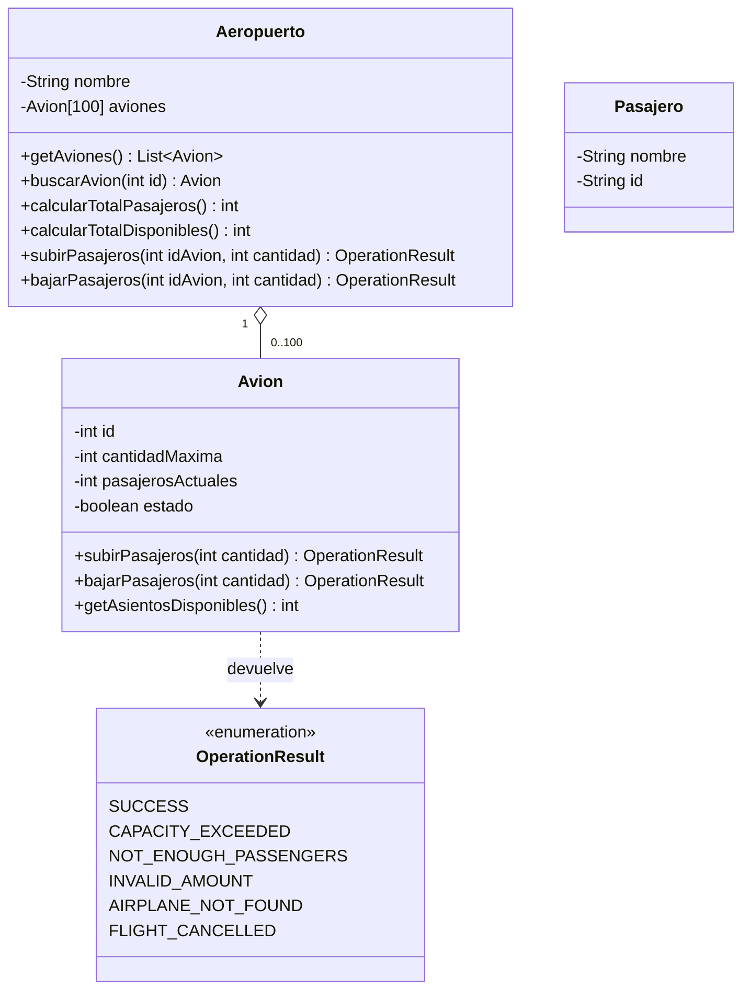

# Sistema de Gestión de Aeropuerto

[](https://github.com/Pazvzv24/gestion_aeropuerto/actions/workflows/ci.yml)


Simulación orientada a objetos del embarque y desembarque de pasajeros en un aeropuerto, escrita en **Java 17**, con **interfaz gráfica moderna** (Swing + FlatLaf, temas claro y oscuro) y modo consola. Cada operación valida sus reglas y devuelve un resultado explícito (patrón *Result Object*), y toda la entrada del usuario se valida antes de usarse.

Proyecto académico de **AIEP**, ramo **Fundamentos de Programación Computacional**, continuado como proyecto de portafolio. Ver [Contexto](#contexto).

---

## Tabla de contenido

- [Funcionalidades](#funcionalidades)
- [Ejecución](#ejecución)
- [Pruebas](#pruebas)
- [Estructura del proyecto](#estructura-del-proyecto)
- [Diseño](#diseño)
- [Reglas del negocio](#reglas-del-negocio)
- [Contexto](#contexto)
- [Historial de versiones](#historial-de-versiones)

---

## Funcionalidades

**Interfaz gráfica** (modo por defecto):

- **Resumen** con tarjetas: aviones, pasajeros a bordo, asientos disponibles y vuelos cancelados.
- **Tabla de aviones** ordenable por columna, con la ocupación como barra de progreso y el estado en color.
- **Panel de operaciones:** se elige un avión, la cantidad y se sube o baja pasajeros; el resultado se muestra al instante. El botón de subir se desactiva en vuelos cancelados.
- **Tema claro y oscuro** con un clic.

**Menú por consola** (con el argumento `--consola`, o automáticamente en equipos sin pantalla):

```
--- Aeropuerto: Aeropuerto Internacional ---
1. Listar los aviones.
2. Total de pasajeros a bordo.
3. Total de asientos disponibles.
4. Buscar avión por ID.
5. Subir pasajeros.
6. Bajar pasajeros.
7. Salir.
Seleccione una opción:
```

Al iniciar, el aeropuerto crea 5 aviones con capacidad (entre 50 y 150 asientos), pasajeros y estado (activo o cancelado) aleatorios.

---

## Ejecución

**Requisitos:** JDK 17 o superior y [Maven](https://maven.apache.org/) 3.9 o superior. Maven descarga solo las librerías (FlatLaf y JUnit).

```bash
# 1. Clonar el repositorio
git clone https://github.com/Pazvzv24/gestion_aeropuerto.git
cd gestion_aeropuerto

# 2. Compilar, ejecutar las pruebas y generar el .jar (incluye FlatLaf)
mvn verify

# 3. Ejecutar la interfaz gráfica
java -jar target/gestion-aeropuerto-2.1.0.jar

# O el menú por consola
java -jar target/gestion-aeropuerto-2.1.0.jar --consola
```

> Si la consola de Windows muestra mal las tildes, ejecuta antes `chcp 65001`.

**Sin instalar Maven:** en Visual Studio Code con el *Extension Pack for Java*, el proyecto se reconoce solo a partir del `pom.xml` (descarga FlatLaf y JUnit automáticamente); `Main.java` se ejecuta con ▶ y las pruebas desde el panel *Testing*.

---

## Pruebas

**26 pruebas unitarias** con JUnit 5, siguiendo el patrón *Arrange, Act, Assert*:

| Clase de prueba | Qué comprueba |
| :--- | :--- |
| `AvionTest` | Subir y bajar pasajeros, límites de capacidad, vuelos cancelados, cantidades inválidas, validación del constructor, porcentaje de ocupación y aviones aleatorios siempre válidos (1.000 casos con semilla fija) |
| `AeropuertoTest` | Creación de los 5 aviones, totales, búsqueda por ID, avión inexistente, lista de solo lectura, IDs repetidos y límite de 100 aviones |
| `MainTest` | Entrada inválida (letras en vez de números), fin de la entrada, una sesión completa del menú y el argumento `--consola` |
| `AvionesTableModelTest` | Que la tabla de la interfaz muestre los datos correctos de cada avión y se actualice tras una operación |

```bash
mvn test
```

En cada push, [GitHub Actions](.github/workflows/ci.yml) compila el proyecto y ejecuta todas las pruebas. [Dependabot](.github/dependabot.yml) avisa si alguna dependencia tiene vulnerabilidades conocidas.

---

## Estructura del proyecto

```
gestion_aeropuerto/
├── pom.xml                          # Configuración de Maven
├── LICENSE                          # Licencia MIT
├── src/
│   ├── main/java/io/github/pazvzv24/aeropuerto/
│   │   ├── Aeropuerto.java          # Agrupa hasta 100 aviones y calcula totales
│   │   ├── Avion.java               # Capacidad, pasajeros y estado de cada avión
│   │   ├── Pasajero.java            # Modelo de pasajero
│   │   ├── OperationResult.java     # Resultados posibles de una operación
│   │   ├── Main.java                # Punto de entrada (ventana o consola)
│   │   └── ui/
│   │       ├── VentanaPrincipal.java    # Interfaz gráfica
│   │       ├── AvionesTableModel.java   # Datos de la tabla de aviones
│   │       └── Tema.java                # Temas claro y oscuro (FlatLaf)
│   └── test/java/io/github/pazvzv24/aeropuerto/
│       ├── AvionTest.java
│       ├── AeropuertoTest.java
│       ├── MainTest.java
│       └── ui/AvionesTableModelTest.java
└── .github/
    ├── workflows/ci.yml             # Integración continua
    └── dependabot.yml               # Revisión de dependencias
```

---

## Diseño



### Patrón Result Object

Las operaciones no lanzan excepciones para los casos esperados (avión lleno, vuelo cancelado, etc.): devuelven un `OperationResult` que se puede revisar de forma clara.

```java
OperationResult resultado = aeropuerto.subirPasajeros(3, 10);

if (resultado.isSuccess()) {
    System.out.println("Embarque exitoso");
} else {
    System.out.println(resultado.getMessage() + " (código " + resultado.getStatusCode() + ")");
}
```

| Resultado | Código | Mensaje |
| :--- | :---: | :--- |
| `SUCCESS` | 200 | Operación exitosa |
| `CAPACITY_EXCEEDED` | 400 | El avión no tiene asientos suficientes |
| `AIRPLANE_NOT_FOUND` | 404 | Avión no encontrado |
| `NOT_ENOUGH_PASSENGERS` | 409 | No hay tantos pasajeros a bordo |
| `INVALID_AMOUNT` | 422 | Cantidad de pasajeros inválida |
| `FLIGHT_CANCELLED` | 503 | El vuelo está cancelado |

Los códigos siguen la idea de los códigos HTTP para que sean fáciles de reconocer.

### Separación entre lógica e interfaz

La interfaz gráfica (paquete `ui`) y el menú por consola **usan las mismas clases del modelo**: ninguna regla del negocio está en las pantallas. Por eso la misma lógica funciona con dos interfaces distintas, y las pruebas revisan las reglas sin necesidad de abrir ventanas.

### Validación y encapsulamiento

- **Entrada del usuario:** si se escribe algo que no es un número, el programa avisa y vuelve a preguntar, en vez de cerrarse con un error.
- **Estado siempre válido:** un avión no puede crearse con capacidad negativa ni con más pasajeros que asientos (el constructor lo rechaza).
- **Operaciones atómicas:** si una operación falla, el avión queda exactamente como estaba.
- **Encapsulamiento:** el arreglo de aviones es privado. `getAviones()` entrega una copia de solo lectura, así nadie puede borrar o reemplazar aviones desde fuera.
- **Pruebas reproducibles:** los aviones aleatorios reciben un generador (`Random`) que en las pruebas usa una semilla fija.

---

## Reglas del negocio

- Solo se pueden subir pasajeros a un vuelo **activo** y hasta completar su capacidad.
- Los pasajeros **siempre pueden bajar**, incluso si el vuelo fue cancelado.
- No se puede bajar más pasajeros de los que hay a bordo.
- Las cantidades deben ser mayores que 0.
- El aeropuerto admite como máximo **100 aviones**, sin IDs repetidos.
- Los totales consideran todos los aviones, activos y cancelados.

---

## Contexto

Este proyecto nació como una evaluación del ramo **Fundamentos de Programación Computacional** (AIEP, primer semestre), en la unidad de introducción a Java. La **v1.0** corresponde a la versión entregada.

Desde la **v1.1** continúa como proyecto de portafolio: corrección de errores, validación de la entrada del usuario y encapsulamiento (v1.1), estructura estándar con Maven, pruebas automáticas e integración continua (v2.0), e interfaz gráfica (v2.1).

No se incluyen el enunciado ni la pauta de evaluación.

---

## Historial de versiones

| Versión | Cambios |
| :--- | :--- |
| v1.0 | Versión entregada en la evaluación: clases `Aeropuerto`, `Avion`, `Pasajero` y `OperationResult`, menú por consola y documentación. |
| v1.1 | Mensaje correcto al bajar más pasajeros de los que hay (`NOT_ENOUGH_PASSENGERS`); el programa ya no se cierra si se escribe texto en vez de un número; validación en los constructores; arreglo de aviones encapsulado; resultado `AIRPLANE_NOT_FOUND`; capacidad aleatoria entre 50 y 150 inclusive; README renovado. |
| v2.0 | Proyecto Maven con paquete `io.github.pazvzv24.aeropuerto` y estructura estándar; 21 pruebas con JUnit 5; integración continua con GitHub Actions; Dependabot; `.jar` ejecutable; licencia MIT. |
| v2.1 | Interfaz gráfica con Swing y FlatLaf: tarjetas de resumen, tabla de aviones con ocupación y estado, panel de operaciones y temas claro y oscuro; el menú por consola sigue disponible con `--consola`; `.jar` único con todas las librerías; 5 pruebas nuevas (26 en total). |

---

Distribuido bajo la licencia [MIT](LICENSE).


