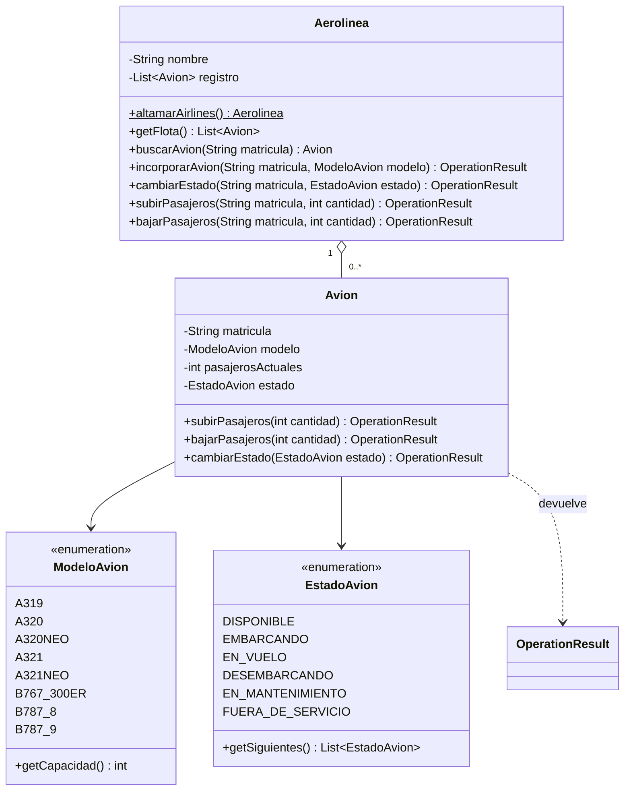
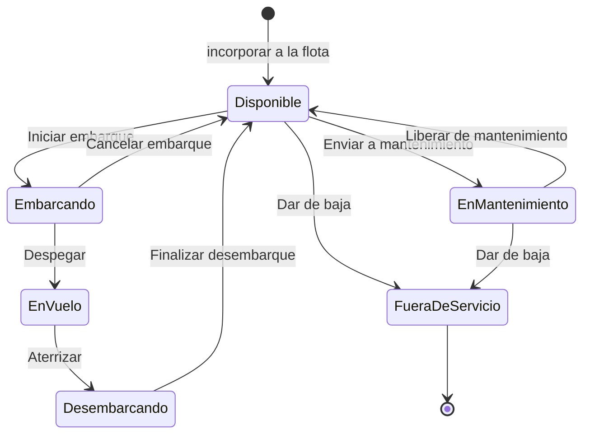

# Altamar Airlines · Gestión de flota

[](https://github.com/Pazvzv24/gestion_aeropuerto/actions/workflows/ci.yml)


Sistema de gestión de flota para **Altamar Airlines**, una aerolínea ficticia, escrito en **Java 17**. Administra los aviones con matrícula chilena, su estado operativo con reglas de una **máquina de estados**, y el embarque y desembarque de pasajeros, con **interfaz gráfica moderna** (Swing + FlatLaf, temas claro y oscuro) y modo consola.

Proyecto académico de **AIEP**, ramo **Fundamentos de Programación Computacional**, continuado como proyecto de portafolio. Ver [Contexto](#contexto).

---

## Tabla de contenido

- [Funcionalidades](#funcionalidades)
- [Ejecución](#ejecución)
- [Pruebas](#pruebas)
- [Estructura del proyecto](#estructura-del-proyecto)
- [Diseño](#diseño)
- [Reglas del negocio](#reglas-del-negocio)
- [Contexto](#contexto)
- [Historial de versiones](#historial-de-versiones)

---

## Funcionalidades

**La flota:** Altamar Airlines opera hoy **15 aviones** y el sistema admite hasta **100** en la flota activa. Cada avión tiene:

- **Matrícula** con el formato chileno `CC-XXX` (por ejemplo, `CC-AMA`).
- **Modelo**, que define su capacidad: Airbus A319, A320, A320neo, A321 y A321neo, y Boeing 767-300ER, 787-8 y 787-9.
- **Estado operativo**: disponible, embarcando, en vuelo, desembarcando, en mantenimiento o fuera de servicio.

**Interfaz gráfica** (modo por defecto):

- **Resumen** con tarjetas: flota activa (de 100), aviones en vuelo, pasajeros a bordo y aviones en mantenimiento.
- **Tabla de la flota** ordenable, con **búsqueda por matrícula** y **filtro por estado**; la ocupación se muestra como barra y el estado en color.
- **Panel de operaciones:** al seleccionar un avión aparecen **solo las acciones que su estado permite** (iniciar embarque, despegar, aterrizar, enviar a mantenimiento, dar de baja…), además de subir y bajar pasajeros.
- **Incorporar aviones** a la flota, validando matrícula y capacidad.
- **Tema claro y oscuro** con un clic.

**Menú por consola** (con el argumento `--consola`, o automáticamente en equipos sin pantalla):

```
--- Altamar Airlines · Gestión de flota ---
1. Listar la flota.
2. Resumen de la flota.
3. Buscar avión por matrícula.
4. Subir pasajeros.
5. Bajar pasajeros.
6. Cambiar estado de un avión.
7. Incorporar avión a la flota.
8. Salir.
Seleccione una opción:
```

---

## Ejecución

**Requisitos:** JDK 17 o superior y [Maven](https://maven.apache.org/) 3.9 o superior. Maven descarga solo las librerías (FlatLaf y JUnit).

```bash
# 1. Clonar el repositorio
git clone https://github.com/Pazvzv24/gestion_aeropuerto.git
cd gestion_aeropuerto

# 2. Compilar, ejecutar las pruebas y generar el .jar (incluye FlatLaf)
mvn verify

# 3. Ejecutar la interfaz gráfica
java -jar target/gestion-aeropuerto-2.2.0.jar

# O el menú por consola
java -jar target/gestion-aeropuerto-2.2.0.jar --consola
```

> Si la consola de Windows muestra mal las tildes, ejecuta antes `chcp 65001`.

**Sin instalar Maven:** en Visual Studio Code con el *Extension Pack for Java*, el proyecto se reconoce solo a partir del `pom.xml` (descarga FlatLaf y JUnit automáticamente); `Main.java` se ejecuta con ▶ y las pruebas desde el panel *Testing*.

---

## Pruebas

**32 pruebas unitarias** con JUnit 5, siguiendo el patrón *Arrange, Act, Assert*:

| Clase de prueba | Qué comprueba |
| :--- | :--- |
| `AvionTest` | Formato de matrícula, capacidad por modelo, subir y bajar pasajeros según el estado, un ciclo de vuelo completo, cambios de estado imposibles, avión con pasajeros que no puede liberarse y validación del constructor |
| `EstadoAvionTest` | Las transiciones permitidas de la máquina de estados, los permisos de pasajeros por estado y los nombres de las acciones |
| `AerolineaTest` | Flota inicial de Altamar (15 aviones, sin matrículas repetidas), totales, búsqueda por matrícula, incorporación de aviones, límite de 100, baja de aviones y lista de solo lectura |
| `MainTest` | Entrada inválida, fin de la entrada, una sesión completa por consola (embarque, error de capacidad y despegue) y el argumento `--consola` |
| `AvionesTableModelTest` | Que la tabla de la interfaz muestre los datos correctos y se actualice tras una operación |

```bash
mvn test
```

En cada push, [GitHub Actions](.github/workflows/ci.yml) compila el proyecto y ejecuta todas las pruebas. [Dependabot](.github/dependabot.yml) avisa si alguna dependencia tiene vulnerabilidades conocidas, y CodeQL analiza la seguridad del código.

---

## Estructura del proyecto

```
gestion_aeropuerto/
├── pom.xml                          # Configuración de Maven
├── LICENSE                          # Licencia MIT
├── src/
│   ├── main/java/io/github/pazvzv24/aeropuerto/
│   │   ├── Aerolinea.java           # Flota (hasta 100 aviones activos) y sus operaciones
│   │   ├── Avion.java               # Matrícula, modelo, pasajeros y estado
│   │   ├── ModeloAvion.java         # Modelos y su capacidad
│   │   ├── EstadoAvion.java         # Estados y cambios permitidos (máquina de estados)
│   │   ├── OperationResult.java     # Resultados posibles de una operación
│   │   ├── Pasajero.java            # Modelo de pasajero
│   │   ├── Main.java                # Punto de entrada (ventana o consola)
│   │   └── ui/
│   │       ├── VentanaPrincipal.java    # Interfaz gráfica
│   │       ├── AvionesTableModel.java   # Datos de la tabla de la flota
│   │       └── Tema.java                # Temas claro y oscuro (FlatLaf)
│   └── test/java/io/github/pazvzv24/aeropuerto/
│       ├── AvionTest.java
│       ├── EstadoAvionTest.java
│       ├── AerolineaTest.java
│       ├── MainTest.java
│       └── ui/AvionesTableModelTest.java
└── .github/
    ├── workflows/ci.yml             # Integración continua
    └── dependabot.yml               # Revisión de dependencias
```

---

## Diseño



### Máquina de estados del avión



Para volver a **Disponible** (al cancelar el embarque o al terminar de desembarcar) el avión debe estar vacío. Cualquier otro cambio, por ejemplo de "En vuelo" a "En mantenimiento" sin aterrizar, se rechaza con `INVALID_TRANSITION`.

### Patrón Result Object

Las operaciones no lanzan excepciones para los casos esperados (avión lleno, cambio de estado no permitido, etc.): devuelven un `OperationResult` que se puede revisar de forma clara.

```java
OperationResult resultado = altamar.cambiarEstado("CC-AMC", EstadoAvion.EN_MANTENIMIENTO);

if (resultado.isSuccess()) {
    System.out.println("Avión enviado a mantenimiento");
} else {
    System.out.println(resultado.getMessage() + " (código " + resultado.getStatusCode() + ")");
}
```

| Resultado | Código | Mensaje |
| :--- | :---: | :--- |
| `SUCCESS` | 200 | Operación exitosa |
| `CAPACITY_EXCEEDED` | 400 | El avión no tiene asientos suficientes |
| `AIRPLANE_NOT_FOUND` | 404 | Avión no encontrado |
| `NOT_ENOUGH_PASSENGERS` | 409 | No hay tantos pasajeros a bordo |
| `OPERATION_NOT_ALLOWED` | 409 | Operación no permitida en el estado actual del avión |
| `INVALID_TRANSITION` | 409 | Cambio de estado no permitido |
| `AIRPLANE_NOT_EMPTY` | 409 | El avión aún tiene pasajeros a bordo |
| `DUPLICATE_REGISTRATION` | 409 | Ya existe un avión con esa matrícula |
| `FLEET_FULL` | 409 | La flota alcanzó su capacidad máxima |
| `INVALID_AMOUNT` | 422 | Cantidad de pasajeros inválida |
| `INVALID_REGISTRATION` | 422 | Matrícula inválida, use el formato CC-XXX |

Los códigos siguen la idea de los códigos HTTP para que sean fáciles de reconocer.

### Separación entre lógica e interfaz

La interfaz gráfica (paquete `ui`) y el menú por consola **usan las mismas clases del modelo**: ninguna regla del negocio está en las pantallas. Por eso la misma lógica funciona con dos interfaces distintas, y las pruebas revisan las reglas sin necesidad de abrir ventanas.

### Validación y encapsulamiento

- **Entrada del usuario:** si se escribe algo inválido, el programa avisa y vuelve a preguntar, en vez de cerrarse con un error.
- **Estado siempre válido:** un avión no puede crearse con una matrícula mal formada, con más pasajeros que asientos, ni con pasajeros en un estado que exige el avión vacío.
- **Operaciones atómicas:** si una operación falla, el avión queda exactamente como estaba.
- **Encapsulamiento:** la flota es privada. `getFlota()` entrega una copia de solo lectura, así nadie puede agregar o quitar aviones sin pasar por las reglas de `Aerolinea`.

---

## Reglas del negocio

- Las matrículas siguen el formato chileno `CC-XXX` y no se repiten.
- La capacidad de cada avión la define su modelo.
- Solo se suben pasajeros durante el **embarque**, y hasta completar la capacidad.
- Se bajan pasajeros durante el embarque (si alguien desiste) o al **desembarcar**; nunca en vuelo.
- Un avión solo vuelve a **disponible**, pasa a **mantenimiento** o se da de **baja** si está vacío.
- Los cambios de estado siguen la máquina de estados; un avión **fuera de servicio** ya no admite cambios.
- La flota activa admite como máximo **100 aviones**. Los dados de baja se conservan en el registro como historial, pero no cuentan como flota activa.

> Altamar Airlines y todas sus matrículas son ficticias; cualquier coincidencia con aviones o empresas reales es casual. Las capacidades de los modelos son referenciales.

---

## Contexto

Este proyecto nació como una evaluación del ramo **Fundamentos de Programación Computacional** (AIEP, primer semestre), en la unidad de introducción a Java. La **v1.0** corresponde a la versión entregada.

Desde la **v1.1** continúa como proyecto de portafolio: corrección de errores, validación de la entrada del usuario y encapsulamiento (v1.1); estructura estándar con Maven, pruebas automáticas e integración continua (v2.0); interfaz gráfica (v2.1), y una aerolínea con flota, matrículas, modelos y estados con reglas (v2.2).

No se incluyen el enunciado ni la pauta de evaluación.

---

## Historial de versiones

| Versión | Cambios |
| :--- | :--- |
| v1.0 | Versión entregada en la evaluación: clases `Aeropuerto`, `Avion`, `Pasajero` y `OperationResult`, menú por consola y documentación. |
| v1.1 | Mensaje correcto al bajar más pasajeros de los que hay (`NOT_ENOUGH_PASSENGERS`); el programa ya no se cierra si se escribe texto en vez de un número; validación en los constructores; arreglo de aviones encapsulado; resultado `AIRPLANE_NOT_FOUND`; capacidad aleatoria entre 50 y 150 inclusive; README renovado. |
| v2.0 | Proyecto Maven con paquete `io.github.pazvzv24.aeropuerto` y estructura estándar; 21 pruebas con JUnit 5; integración continua con GitHub Actions; Dependabot; `.jar` ejecutable; licencia MIT. |
| v2.1 | Interfaz gráfica con Swing y FlatLaf: tarjetas de resumen, tabla de aviones con ocupación y estado, panel de operaciones y temas claro y oscuro; el menú por consola sigue disponible con `--consola`; `.jar` único con todas las librerías; 5 pruebas nuevas (26 en total). |
| v2.2 | Altamar Airlines: `Aeropuerto` pasa a ser `Aerolinea`, con flota de 15 aviones y capacidad para 100; matrícula chilena `CC-XXX`; modelos reales con su capacidad (`ModeloAvion`); estados operativos con máquina de estados (`EstadoAvion`); incorporar y dar de baja aviones; búsqueda por matrícula y filtro por estado en la interfaz; 6 resultados nuevos; 32 pruebas. |

---

Distribuido bajo la licencia [MIT](LICENSE).